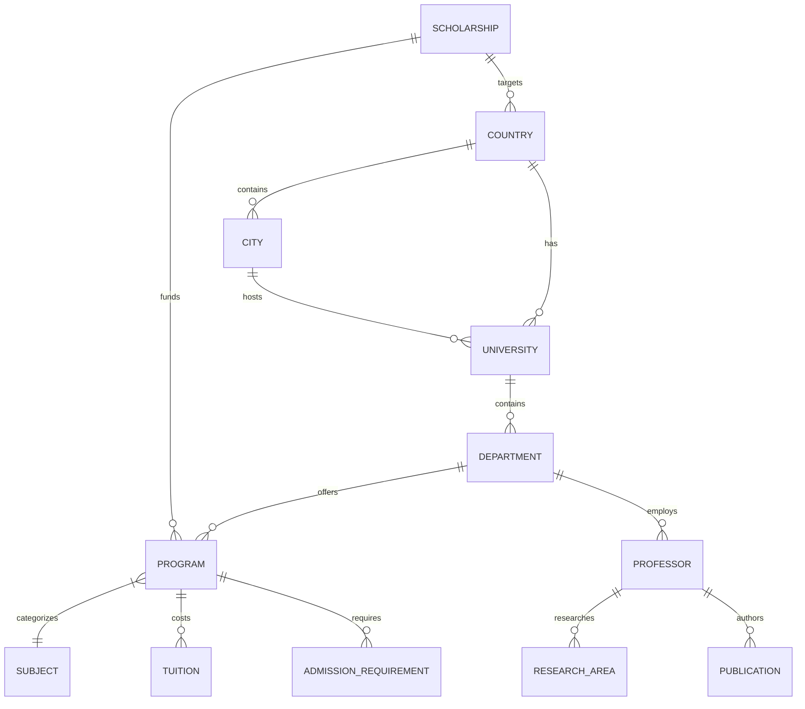

# Global Academic Intelligence Platform - Production PRD & Architecture

## 1. Product Requirements Document (PRD)

**Vision:** A trustworthy global academic intelligence and knowledge platform, powered by automated data collection, human verification, structured research data, editorial content, and a sustainable audience-based business model.

**Target Audience:**
1. **Students** (Undergraduate, Master's, PhD, International) seeking universities, programs, costs, and funding.
2. **Researchers & Academics** seeking collaborators, grants, opportunities, and institutions.
3. **Parents** seeking total education cost, safety, and ROI.
4. **Governments/NGOs** analyzing education trends.

**Core Offerings (MVP):**
- **University Database:** 500-1,000 top institutions with campus, faculty, and cost info.
- **Program Database:** 5,000-10,000 programs across 10-15 countries.
- **Scholarship/Funding Database:** 1,000+ verified scholarships and assistantships.
- **Professor Database:** 50,000+ profiles with structured research interests.
- **Search & Alerts:** Cross-relational search (e.g., "Fully funded Cybersecurity Master's in Europe").

---

## 2. Database Entity Relationship Diagram (ERD)



### Core Models (PostgreSQL)
*   **Location:** `Country`, `City`, `LivingCost`
*   **Institution:** `University`, `Faculty`, `Department`, `Laboratory`
*   **Academics:** `Subject`, `Program`, `Degree`, `AdmissionRequirement`, `Tuition`
*   **People:** `Professor`, `ProfessorAffiliation`, `ResearchArea`, `Publication`
*   **Funding:** `Scholarship`, `Assistantship`, `Grant`
*   **System:** `Source`, `ScrapeJob`, `DataChange`, `VerificationRecord`
*   **Users:** `User`, `SavedItem`, `AlertRule`, `Subscription`

---

## 3. Django / DRF Architecture

```text
backend/
├── manage.py
├── core/                  # Core settings (base, dev, prod)
├── apps/
│   ├── locations/         # Countries, Cities, Living Costs
│   ├── institutions/      # Universities, Departments, Labs
│   ├── programs/          # Degrees, Programs, Subjects, Tuition
│   ├── people/            # Professors, Affiliations
│   ├── research/          # Topics, Publications
│   ├── funding/           # Scholarships, Grants, Assistantships
│   ├── scraping/          # Celery tasks, Parsers, Jobs, Results
│   ├── verification/      # Data Changes, Provenance, Sources
│   ├── accounts/          # Auth, Profiles, Saved Searches, Alerts
│   └── api/               # DRF Routers & Versioning (v1)
```

**Service Layer Pattern:**
Views handle HTTP. Business logic (data normalization, matching, saving) is extracted to `services/` (e.g., `ProgramService.normalize_tuition()`).

---

## 4. Scraper Architecture

**Engine:** Celery + Redis for async tasks.
**Libraries:** `httpx` (fetching), `BeautifulSoup` (parsing).

**Pipeline:**
1.  **Scheduler (Celery Beat):** Triggers `scrape_university(id)` based on source health and update frequency.
2.  **Adapter (BaseScraper):** Abstract class implemented by source-specific parsers (e.g., `HarvardScraper`, `FulbrightScraper`).
3.  **Fetcher:** Implements domain-specific rate-limiting and rotating user-agents.
4.  **Parser & Normalizer:** Extracts raw HTML to structured JSON (DTOs).
5.  **Deduplicator (Entity Resolution):** Resolves canonical IDs (e.g., matching "MIT" to `UNI-US-MIT`).
6.  **Change Detector:** Compares new JSON to database. If change detected -> create `DataChange` -> Update record.

---

## 5. API Specification (v1)

**RESTful DRF Endpoints:**
*   `GET /api/v1/universities/?country=ca&has_scholarship=true`
*   `GET /api/v1/programs/?subject=cybersecurity&degree=master`
*   `GET /api/v1/funding/?type=fully_funded&deadline_after=2026-09-01`
*   `GET /api/v1/professors/?research_area=machine-learning`
*   `POST /api/v1/alerts/` (Auth required)

**Optimization:**
*   Pagination (limit 100).
*   Throttling (Anon: 60/hr, Free Auth: 500/day).
*   Selected fields via serializers (ListSerializer vs DetailSerializer).

---

## 6. Next.js Page Architecture & SEO

**Tech:** Next.js (App Router), React, TailwindCSS.

**Routes & SEO Strategy (Programmatic SEO):**
*   `/` (Homepage with global search)
*   `/countries/[slug]` (e.g., `/countries/canada` - Universities, Costs, Visas)
*   `/universities/[slug]` (e.g., `/universities/toronto` - Programs, Costs, Faculty)
*   `/programs/[subject]/[country]` (e.g., `/programs/cybersecurity/germany` - Highly targeted SEO)
*   `/scholarships/[level]/[country]` (e.g., `/scholarships/phd/uk`)
*   `/professors/[research-area]`
*   `/insights/[article-slug]` (Editorial Content)

**Rendering:** Incremental Static Regeneration (ISR) for fast TTFB on database-driven pages.

---

## 7. Monetization Model

**Phase 1 (Audience Building):**
*   **Free:** 100% of data.
*   **SEO Traffic -> Newsletter Signups.**

**Phase 2 (Monetization):**
*   **Advertising:** Contextual, non-intrusive ads (e.g., GRE prep on program pages).
*   **Newsletter Sponsorship:** "Sponsored by University X".
*   **Premium Membership:** ($5-$10/mo) Unlimited saved alerts, personalized deadline tracking, advanced comparison tools, historical data access.

---

## 8. 3-Year Scaling Roadmap

### Year 1: Data Infrastructure & Trust (MVP)
*   **Q1:** Build Django backend, Postgres schema, Celery scraper framework. Implement 10 core university adapters and 3 scholarship sources.
*   **Q2:** Build Next.js frontend. Launch programmatic SEO pages for MVP data.
*   **Q3:** Implement data versioning, change detection, and admin verification dashboards.
*   **Q4:** Launch newsletter. Implement user accounts for saved items and basic alerts.

### Year 2: Expansion & Monetization
*   **Q1:** Scale scrapers to 5,000 universities. Implement advanced Elasticsearch/OpenSearch.
*   **Q2:** Launch Premium Membership (advanced alerts, comparisons).
*   **Q3:** Launch Cost Calculator and Living Cost databases.
*   **Q4:** Begin editorial content (Data Journalism) and research reports.

### Year 3: Global Academic Graph
*   **Q1:** Scale to millions of professor/publication relationships.
*   **Q2:** Implement graph-based recommendation engines (Similar programs, researchers).
*   **Q3:** Institutional dashboards and B2B research data access.
*   **Q4:** Multi-language support (Spanish, Mandarin, French).
